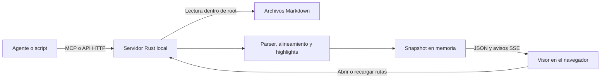

# mddiff

[](https://github.com/joalceco/mddiff/actions/workflows/ci.yml)

**Lee Markdown y compara dos versiones renderizadas, lado a lado, sin modificar los archivos.**

mddiff es una herramienta local para revisar documentos y propuestas de una IA. Conserva encabezados, listas, tablas y código; alinea los bloques y resalta las palabras que cambiaron. Un único proceso Rust sirve el visor, una API HTTP y un servidor MCP. Un agente puede abrir una comparación y actualizar el navegador que ya tienes abierto.

El proyecto está en versión **0.1.0 / PMV**. La interfaz y los mensajes están en español. El modo local no requiere Node.js, una cuenta, claves de API ni un servicio de IA para funcionar. El modo alojado en desarrollo autentica sesiones web mediante Keycloak; todavía no es una beta pública.

**Ir a:** [Inicio rápido](#inicio-rápido) · [Uso](#usar-el-visor) · [MCP y Codex](#usar-desde-codex-con-mcp) · [API](#api-http) · [Privacidad](#privacidad-y-límites-de-confianza) · [Desarrollo](#desarrollo-y-pruebas) · [Rendimiento](#rendimiento) · [Problemas frecuentes](#problemas-frecuentes)

## Qué incluye

| Capacidad | Comportamiento |
| --- | --- |
| Lectura | Muestra un documento sin marcas de comparación. |
| Comparación renderizada | Original a la izquierda y propuesta a la derecha, con filas alineadas. |
| Detalle de cambios | Fondo rojo o verde por bloque, signos `−` y `+`, y un highlight más intenso en las palabras modificadas. |
| Vista de fuente | Markdown exacto, rangos de líneas y fragmentos de sintaxis modificados. |
| Entradas alojadas | Pegar texto o subir `.md` desde las cabeceras; apertura y comparación automáticas. |
| Original desde Memos | Capturar una nota por ID o URL con la conexión personal y conservar su procedencia. |
| Integración | MCP/API local por rutas y MCP/API alojados con OAuth de usuario. |
| Actualización de la vista | SSE avisa al navegador cuando otra solicitud abre un documento o una comparación. |
| Navegación | Botones y atajos `J` / `K` para recorrer los cambios. |
| Tema | Oscuro de forma predeterminada, con selector de tema y preferencia guardada en el navegador. |

El Markdown admite encabezados, párrafos, énfasis, enlaces y referencias, citas, listas, tablas, tachado, listas de tareas y bloques de código. Las casillas de tareas son de solo lectura. Las imágenes no se muestran.

## Inicio rápido

Necesitas Git, una versión estable reciente de Rust con Cargo y un navegador moderno. Se ha verificado localmente con Rust 1.95.0 en macOS arm64; la integración continua ejecuta las comprobaciones en Linux. No se ha establecido una versión mínima de Rust ni verificado Windows.

1. Clona el repositorio:

   ```sh
   git clone https://github.com/joalceco/mddiff.git
   cd mddiff
   ```

2. Compila e inicia la comparación de ejemplo:

   ```sh
   cargo run --release --locked -- --root . --port 3847 examples/base.md examples/propuesta.md
   ```

3. Abre [el visor local](http://127.0.0.1:3847/) en tu navegador.

4. Detén el servidor con `Ctrl-C` cuando termines.

La primera compilación descarga las dependencias de Rust. El visor no abre una ventana por sí mismo. Los ejemplos incluidos son documentos de demostración sobre mddiff.

### Iniciar con tus documentos

Para empezar sin una comparación cargada:

```sh
cargo run --release --locked -- --root ./mis-documentos --port 3847
```

Crea esa carpeta o usa una que ya exista. Las rutas introducidas en el visor, la API o MCP se resuelven respecto de `--root`, aunque el proceso se ejecute desde otra carpeta.

Para abrir dos documentos desde el inicio:

```sh
cargo run --release --locked -- --root ./mis-documentos original.md propuesta.md
```

Los dos archivos deben existir dentro de la raíz autorizada. Si una ruta contiene espacios, escríbela entre comillas en la terminal.

### Compilar o instalar el binario

```sh
cargo build --release --locked
./target/release/mddiff --root . examples/base.md examples/propuesta.md
```

También puedes instalarlo en el directorio de binarios de Cargo:

```sh
cargo install --locked --path .
mddiff --root ./mis-documentos
```

La interfaz está incorporada en el binario. No necesitas copiar `web/` para ejecutarlo. Los documentos de `examples/` permanecen como archivos separados: **Probar con un ejemplo** requiere que estén dentro de la raíz autorizada.

### Opciones de línea de comandos

```text
mddiff [--mode local|hosted] [--root CARPETA] [--port PUERTO] [--oidc-config ARCHIVO] [--data-dir CARPETA] [--connections-config ARCHIVO] [original.md propuesta.md]
```

| Argumento | Valor predeterminado | Descripción |
| --- | --- | --- |
| `--mode local\|hosted` | `local` | Selecciona el lector local o el modo alojado con espacios privados. |
| `--root CARPETA` | `.` | Carpeta existente cuyos Markdown puede abrir el modo local. No se acepta en hosted. |
| `--port PUERTO` | `3847` | Puerto HTTP. `0` solicita uno libre; la terminal muestra la URL asignada. |
| `--oidc-config ARCHIVO` | Sin configuración | JSON privado del proveedor Keycloak; solo se acepta en hosted. |
| `--connections-config ARCHIVO` | Deshabilitadas | Destinos aprobados, cliente Jira y referencia a la clave externa de conexiones; requiere hosted y OIDC. |
| `--data-dir CARPETA` | Sin directorio | Obligatorio en hosted para el trabajo actual persistente. No se acepta en local. |
| `original.md propuesta.md` | Sin documentos | Abre una comparación inicial. Se aceptan dos rutas o ninguna. |
| `--help`, `-h` | — | Muestra el uso y termina. |

Para leer un solo archivo, inicia sin rutas y usa el visor o `POST /api/open`.

### Modos local y alojado

El modo **local** es el predeterminado. Conserva el lector, la API de archivos, el MCP local y las validaciones de `--root` descritos en este README.

El modo **hosted** integra login web OIDC con Keycloak mediante Authorization Code + PKCE y conserva el trabajo actual de cada persona en SQLite. Requiere un directorio de datos privado y su configuración OIDC; ambos deben estar fuera del repositorio. El archivo JSON requiere permisos `0600` y el directorio de datos, `0700` en Unix. La aplicación crea la carpeta final si falta; su padre debe existir:

```sh
cargo run --release --locked -- --mode hosted --port 3848 \
  --oidc-config "$HOME/.config/mddiff/oidc.json" \
  --data-dir "$HOME/.local/share/mddiff"
```

Las cuentas requieren el rol `mddiff-user`; autenticar en el proveedor no concede acceso por sí solo. Las sesiones usan cookies opacas `HttpOnly` y, con HTTPS, `Secure` y prefijo `__Host-`. El backend verifica el access token por introspección en cada solicitud y vuelve a comprobar los eventos SSE durante la espera. La identidad estable es `issuer` + `sub`, sin selección de propietario mediante headers o campos del cliente.

Sin configuración OIDC, estado, trabajo y eventos siguen rechazando el acceso con `401`. En hosted no se construye un lector de archivos ni se registran `POST /api/open` o `POST /api/compare`; la CLI rechaza `--root` y rutas posicionales. La interfaz admite texto pegado y archivos Markdown, sin abrir rutas del host. Con OIDC configurado, `/mcp` recibe propuestas mediante OAuth Bearer de usuario. Las conexiones personales a Jira/Memos pueden configurarse y las notas de Memos ya pueden abrirse como original; la lectura de Jira sigue pendiente.

Cada persona obtiene su propio snapshot, bloqueo y canal de revisiones. Solo se conserva el último original y su propuesta, sin historial. Reiniciar recupera ese par y su revisión; las sesiones web siguen en memoria y requieren autenticarse otra vez. Google/GitHub siguen pendientes y el proceso permanece limitado a loopback. Consulta [el trabajo persistente](docs/planning/current-work.md), [la autenticación web](docs/planning/hosted-auth.md) y [el acceso de agentes remotos](docs/planning/remote-agents.md).

## Usar el visor

### Conectar Jira Cloud y Memos en hosted

Administración habilita destinos con `--connections-config` y una clave externa de 32 bytes para cifrar las credenciales. Desde **Conexiones**, junto a **Cerrar sesión**, cada usuario puede conectar, comprobar y desconectar sus cuentas. Jira solicita consentimiento OAuth de lectura; Memos 0.31 utiliza un token personal con un aviso explícito sobre su alcance. Desconectar conserva el trabajo actual.

Las credenciales se cifran con AES-256-GCM y no se devuelven al navegador o MCP. El conector solo hace lecturas de negocio. El token de Memos puede permitir cambios fuera de mddiff; desconectar elimina su copia local y la revocación en el proveedor se realiza por separado. Consulta [la configuración, límites y pruebas de conexiones personales](docs/planning/personal-connections.md).

En modo local, abre documentos mediante sus rutas:

1. Pega la ruta del original en su cabecera. El documento se abre automáticamente después de una pausa breve al escribir; `Enter` lo abre de inmediato.
2. Pega la ruta de la propuesta en la otra cabecera. La comparación empieza automáticamente al tener ambos archivos.
3. Elige **Lectura** para leer el original o **Comparación** para revisar ambos paneles.
4. Alterna entre **Markdown** y **Fuente** para revisar el resultado renderizado o el texto exacto.
5. Usa `J` para el cambio siguiente y `K` para el anterior, o los botones de flechas. La navegación vuelve al principio al llegar al final.

**Recargar**, junto a **Conectado**, vuelve a leer los archivos desde disco. También puedes repetir la llamada a la API o a MCP. No hay un observador automático de cambios en disco.

### Pegar o subir documentos en hosted

1. Entra con una cuenta admitida y elige **Pegar texto** o **Subir .md** en la cabecera de **Original**.
2. Pega el contenido o selecciona un archivo `.md`/`.markdown` UTF-8 de hasta 2 MiB. Espera el estado **Abierto y guardado**.
3. Aporta la **Propuesta** desde su cabecera; sus controles se habilitan al tener original. La comparación aparece automáticamente, sin un botón adicional.
4. Para reemplazar cualquiera de los lados, repite la entrada en su cabecera. El otro lado se conserva.
5. Usa **Cerrar texto** para volver a la lectura. Si hay un cambio pendiente, lo guarda antes de cerrar; si falla, el campo permanece abierto. Solo hay un campo de pegado activo.

El texto se abre tras una pausa de 350 ms; cerrar el campo permite guardar de inmediato. Los controles de otras entradas quedan deshabilitados mientras haya un cambio pendiente o en curso. Un pegado completo conserva los saltos recibidos del portapapeles; una edición o un pegado parcial puede normalizarlos a LF. Los archivos conservan Unicode, BOM, CRLF y ausencia de salto final, y rechazan UTF-8 inválido. El nombre base se usa como etiqueta; no se envía una ruta para abrirla en el servidor.

Un conflicto `409` conserva el trabajo vigente y el borrador de texto visible. Copia lo que quieras conservar y cierra/reabre el campo antes de reintentar; un archivo debe seleccionarse de nuevo. Los eventos SSE no cambian automáticamente la revisión de un borrador pendiente. Consulta [la guía de entradas manuales](docs/planning/manual-imports.md) para errores, sesiones y fidelidad del contenido.

### Abrir una nota de Memos como original

En hosted, pulsa **Abrir Memos** en la cabecera de **Original**, elige una conexión personal conectada e introduce el ID o la URL de una nota de esa instancia. **Abrir** captura su Markdown exacto, conserva la propuesta actual y muestra su procedencia. La captura no se sincroniza automáticamente y no importa adjuntos.

La integración soporta Memos 0.31.0 y requiere las conexiones de S07. Los fallos conservan el trabajo vigente; un conflicto obliga a revisar antes de reintentar. Consulta [las referencias admitidas, API, procedencia y pruebas](docs/planning/memos-source.md).

Los atajos no se activan mientras escribes en un campo. El tema se cambia desde **Modo claro** / **Modo oscuro** y se conserva en el mismo navegador. Un error al abrir una ruta mantiene el último documento o comparación válidos.

En modo local, todas las pestañas conectadas al mismo proceso comparten la comparación actual. Para revisar pares locales independientes, inicia procesos con puertos distintos. En hosted, el espacio lo decide la identidad verificada y las pestañas de una misma persona comparten su espacio.

En hosted, **Borrar trabajo**, en la barra de revisión, solicita una confirmación cancelable y elimina el original y la propuesta vigentes. La nueva revisión vacía también las pestañas conectadas de esa persona. El borrado conserva el contador de revisión para rechazar solicitudes anteriores; sus límites de eliminación física se explican en [la política del trabajo actual](docs/planning/current-work.md#borrado-funcional-copias-y-retención).

### Interpretar el diff

El motor compara bloques completos: encabezados, párrafos, listas, tablas y bloques de código. Dentro de un grupo modificado, busca bloques similares conservando su orden. Así, un párrafo añadido puede ocupar una fila propia sin desplazar los párrafos correspondientes que le siguen.

| Señal | Significado |
| --- | --- |
| Fondo rojo y `−` | Bloque del original eliminado o sustituido. |
| Fondo verde y `+` | Bloque añadido o versión propuesta de un bloque sustituido. |
| Highlight más intenso | Palabras o fragmentos eliminados o añadidos dentro del bloque. |
| Espacio vacío frente a un bloque | No hay un bloque correspondiente en ese lado. |
| Contadores de bloques | Cantidad de bloques afectados; no son conteos de líneas de Git. |

Un reemplazo cuenta como un bloque eliminado y otro añadido. El número de cambios navegables cuenta filas modificadas, por lo que puede diferir de la suma de ambos contadores.

El motor conserva tanto la fuente como el contexto global del Markdown. Una referencia de enlace modificada puede cambiar un bloque cuyo texto local es igual. También puede haber cambios de sintaxis que produzcan el mismo HTML, como `**texto**` y `__texto__`: revísalos en **Fuente**. El detalle de HTML escrito directamente también se revisa allí.

No se identifican movimientos de párrafos como una operación distinta. Las listas y tablas se alinean como bloques completos; el resaltado interior ayuda a localizar los cambios.

## Usar desde Codex con MCP

Ambos modos usan **Streamable HTTP** con el SDK Rust `rmcp`. En modo local, el endpoint es `http://127.0.0.1:3847/mcp` y abre archivos dentro de `--root`. En hosted, el endpoint utiliza el origen HTTPS configurado, OAuth y el espacio privado del usuario; sus herramientas reciben contenido, sin rutas del host.

### Comparar archivos en modo local

1. Inicia mddiff con la raíz que contiene tus dos documentos y mantén el proceso en ejecución.
2. Registra el servidor una vez en Codex:

   ```sh
   codex mcp add mddiff --url http://127.0.0.1:3847/mcp
   ```

3. Si no aparece la herramienta, vuelve a conectar los servidores MCP o inicia una sesión nueva de Codex.
4. Pide la comparación:

   ```text
   Usa el MCP mddiff y llama a open_comparison con:
   base_path: examples/base.md
   candidate_path: examples/propuesta.md

   El primero es el original y el segundo es la propuesta.
   Después, abre viewer_url en el navegador disponible para mostrarme el diff.
   ```

El ejemplo supone `--root .` desde el repositorio. Para tus documentos, sustituye las rutas. El cliente MCP debe poder acceder al servidor en el mismo equipo; las rutas siempre pertenecen al sistema de archivos del servidor.

Si cambias de puerto, actualiza la URL registrada. El servidor debe estar iniciado antes de que el cliente intente conectarse. mddiff actualiza un visor abierto; abrir una pestaña cuando todavía no existe depende de las herramientas del cliente.

### Contrato de `open_comparison`

```json
{
  "base_path": "examples/base.md",
  "candidate_path": "examples/propuesta.md"
}
```

Ambos campos son obligatorios. No se admiten propiedades adicionales. Las rutas pueden ser relativas a `--root` o absolutas dentro de ella.

En caso de éxito, `structuredContent` contiene `viewer_url`, `base_path`, `candidate_path`, `revision`, `added_blocks`, `removed_blocks`, `source_equal` y `processing_ms`. Los errores de apertura se devuelven como resultado MCP con `isError: true`; los argumentos que incumplen el esquema pueden producir un error de protocolo. En ambos casos se conserva la comparación anterior.

La herramienta cambia el estado del visor y no escribe archivos. No necesita autenticación ni credenciales; está limitada al servidor local. Otros clientes compatibles con Streamable HTTP pueden usar la misma URL y herramienta.

### Enviar una propuesta en hosted

Configura un cliente público prerregistrado en Keycloak con PKCE `S256`, scope `mddiff:compare` y audiencia igual a la URI HTTPS de `/mcp`. Codex solicita `openid`, `profile` y `mddiff:compare`; el callback del procedimiento probado es `http://127.0.0.1:43210/callback`. La [guía de agentes remotos](docs/planning/remote-agents.md#configurar-codex) incluye el TOML y el login OAuth.

El agente llama a `get_current_work` con `{}` y conserva la revisión recibida. Después llama a `submit_proposal` con `{expected_revision, candidate:{label, markdown}}`. Esa operación conserva el original, actualiza el visor por SSE y devuelve `viewer_url`; requiere un original ya abierto. Si recibe `409`, debe detenerse y comunicar el conflicto.

MCP alojado no admite cookies de sesión, rutas, propietarios elegidos por el cliente ni un `Mcp-Session-Id`. Sus errores de operación devuelven `isError: true` con `structuredContent.status` y `error`. No mezcles Bearer y cookie ni uses credenciales Jira/Memos como token de mddiff. Consulta [el prompt de uso](docs/planning/remote-agents.md#prompt-de-uso).

## API HTTP

Todos los ejemplos de apertura por rutas usan el modo local, el puerto predeterminado y el servidor iniciado desde el repositorio con `--root .`. Hosted no registra esos endpoints de archivos; sus rutas de sesión se describen en [la guía de autenticación](docs/planning/hosted-auth.md) y sus operaciones de contenido, en [la API del trabajo actual](docs/planning/current-work.md#api-del-trabajo-actual).

### Abrir un documento

```sh
curl --fail-with-body http://127.0.0.1:3847/api/open \
  -H 'Content-Type: application/json' \
  -d '{"path":"examples/base.md"}'
```

### Abrir una comparación

```sh
curl --fail-with-body http://127.0.0.1:3847/api/compare \
  -H 'Content-Type: application/json' \
  -d '{"base_path":"examples/base.md","candidate_path":"examples/propuesta.md"}'
```

Una solicitud correcta sustituye el estado visible, aumenta `revision` y avisa a los visores conectados. Los archivos en disco permanecen intactos.

### Consultar el estado y las actualizaciones

```sh
curl --fail-with-body http://127.0.0.1:3847/api/state
```

```sh
curl --no-buffer http://127.0.0.1:3847/api/events
```

| Endpoint | Entrada | Respuesta correcta |
| --- | --- | --- |
| `POST /api/open` | JSON con `path` | Snapshot del documento abierto. |
| `POST /api/compare` | JSON con `base_path` y `candidate_path` | Snapshot de la comparación. |
| `GET /api/state` | Sin cuerpo | Último snapshot, inicialmente sin documentos. |
| `GET /api/events` | Sin cuerpo | Flujo SSE con eventos `revision`. |
| `/mcp` | Protocolo MCP Streamable HTTP | Inicialización, descubrimiento y llamada de herramientas MCP. |

Los POST locales requieren `Content-Type: application/json` y rechazan campos desconocidos. El cuerpo de esas solicitudes admite hasta 16 KiB; el contenido de los documentos se lee desde las rutas, no se envía en ese JSON.

### Trabajo actual en hosted

| Endpoint | Uso |
| --- | --- |
| `GET /api/work` | Lee `{revision, base, candidate}` con el contenido actual de la persona autenticada. |
| `PUT /api/work` | Reemplaza el trabajo con `{expected_revision, base, candidate}`. Cada documento contiene `label` y `markdown`; la propuesta puede ser `null`. |
| `PATCH /api/work` | Envía `{expected_revision, candidate}` para sustituir solo la propuesta y conservar el original. Requiere un original ya abierto. |
| `DELETE /api/work` | Borra ambos lados usando `{expected_revision}`; mantiene el contador incrementado. |

Las mutaciones por sesión web requieren admisión, Origin exacto y su token CSRF. Los agentes pueden usar Bearer OAuth para GET, PUT y PATCH; DELETE con Bearer devuelve `403`. No se mezclan ambas credenciales. Las mutaciones devuelven un snapshot como `/api/state`; un conflicto de revisión devuelve `409` sin sobrescribir el trabajo. Un fallo de almacenamiento devuelve `503` y conserva el último estado publicado. Véase [el contrato para agentes](docs/planning/remote-agents.md#api-para-agentes).

Cada documento admite 2 MiB y cada etiqueta, entre 1 y 255 bytes UTF-8 sin caracteres de control. La petición de `/api/work` admite 24 MiB + 16 KiB para los escapes de JSON; este margen no amplía el tamaño de cada documento. Consulta [los ejemplos de revisión y recuperación](docs/planning/current-work.md#ejemplo-de-revisión-esperada).

### Estructura del snapshot

| Campo | Descripción |
| --- | --- |
| `revision` | Número de actualización. En local se reinicia con el proceso; en hosted persiste y aumenta incluso al borrar. |
| `base_path`, `candidate_path` | Rutas absolutas resueltas en local; etiquetas de presentación en hosted, sin acceso al sistema de archivos. Son `null` cuando no hay documento en ese lado. |
| `comparison` | Objeto con `rows`, `added`, `removed` y `source_equal`; inicialmente es `null`. |
| `processing_ms` | Tiempo de procesamiento en Rust, en milisegundos. |

Cada fila de `comparison.rows` contiene `kind` (`equal`, `replace`, `insert` o `delete`), `left` y `right`. Un lado ausente es `null`. Cada bloque conserva `source`, HTML saneado en `html`, y `start_line` / `end_line` con numeración desde 1. Los campos opcionales `highlighted_html` y `highlighted_source` contienen el detalle resaltado cuando corresponde. Cada fragmento de `highlighted_source` tiene `text` y `changed`.

Al abrir solo un documento, la comparación interna usa ese mismo texto en ambos lados y `candidate_path` es `null`. La interfaz presenta únicamente el original.

El SSE envía la revisión vigente al conectar y las posteriores cuando cambia el estado. No es un historial de eventos: consulta `/api/state` para obtener la versión actual. El navegador se reconecta si el servidor se reinicia.

### Errores

Los errores de apertura de la API usan un cuerpo como `{"error":"El archivo debe estar dentro de la carpeta autorizada."}`. Los códigos principales son:

| HTTP | Causa habitual |
| --- | --- |
| `400` | Ruta inexistente, fuera de la raíz, tipo de archivo incorrecto, UTF-8 inválido o JSON mal formado. |
| `403` | Host, Origin o solicitud entre sitios no permitidos. |
| `409` | Revisión esperada obsoleta al reemplazar o borrar el trabajo alojado. |
| `413` | Documento de más de 2 MiB o solicitud demasiado grande. |
| `415` | Content-Type distinto de `application/json`. |
| `422` | JSON válido que no cumple el contrato de campos. |
| `500` | Fallo interno al procesar el documento. |
| `503` | Almacenamiento alojado o proveedor de identidad no disponible. |

## Privacidad y límites de confianza

En modo local, el visor lee archivos y mantiene la comparación en memoria. No guarda documentos, no incorpora llamadas a modelos ni envía contenido a servicios de análisis. El tema es la única preferencia que la interfaz escribe en `localStorage`. Reiniciar el servidor elimina su estado en memoria; puedes abrir de nuevo los archivos o indicarlos al arrancar.

En hosted, SQLite conserva únicamente el trabajo actual por persona: original, propuesta, etiquetas y revisión. El HTML y el diff se recalculan al recuperarlo. Las sesiones y tokens del IdP permanecen en memoria en el backend y no se exponen al navegador. El cierre de sesión invalida el SID local e intenta revocar el refresh token; no garantiza un cierre global del SSO ni borra el trabajo persistente.

El cliente remoto obtiene su propio token OAuth para mddiff. El backend lo verifica mediante introspección en cada solicitud, con emisor, sujeto, audiencia, scope y admisión; no almacenes ese Bearer en ejemplos, logs públicos o el repositorio. Las herramientas comparten únicamente el espacio de la identidad verificada y tratan el Markdown como datos del documento.

El archivo OIDC y el directorio de datos deben permanecer fuera del checkout, con permisos privados. La base guarda el Markdown en claro; los permisos no equivalen a cifrado. Borrar elimina el contenido recuperable por la aplicación, pero WAL, copias, snapshots y el SSD pueden conservar bytes anteriores. No se crean backups automáticos ni se ha fijado una retención: esa política debe cerrarse antes del despliegue público. Consulta [los límites del borrado y las copias](docs/planning/current-work.md#borrado-funcional-copias-y-retención).

La interfaz se sirve desde el propio binario, usa fuentes del sistema y bloquea la carga de imágenes. Abrir un enlace externo del documento lleva al destino elegido en una pestaña nueva. La política de datos del agente o cliente MCP que utilices es independiente de mddiff.

### Acceso a los archivos

- Cada documento debe ser un archivo normal `.md` o `.markdown`, en UTF-8 y de hasta **2 MiB**.
- `--root` limita la lectura; las rutas se canonicalizan y se rechazan los enlaces simbólicos cuyo destino queda fuera de ella.
- El proceso no crea, modifica ni elimina los archivos comparados.
- El snapshot expone la fuente completa y las rutas resueltas a los clientes que pueden conectarse al servidor local.
- Usa como raíz la carpeta de documentos necesaria. No hace falta autorizar el directorio personal completo.

### Acceso al servidor

El servidor escucha en `127.0.0.1`, comprueba `Host` y `Origin`, rechaza solicitudes entre sitios y aplica una política CSP restrictiva. El HTML renderizado se sanea con `ammonia`, incluido el HTML que contiene highlights. La fuente se inserta como texto.

**El modo local es una herramienta de un solo usuario.** No incluye autenticación ni aislamiento entre usuarios del mismo equipo. Un proceso local con acceso al puerto puede leer el estado o solicitar otros Markdown dentro de la raíz autorizada. No lo expongas mediante un proxy público o un túnel remoto.

El modo hosted incorpora autenticación y separación de propietarios, pero todavía no configura TLS ni un listener público. Su sesión exige admisión en Keycloak; las mutaciones por cookie requieren Origin exacto y un token CSRF asociado a la sesión. La excepción HTTP de pruebas solo se admite con `allow_insecure_loopback: true` y ambos orígenes en loopback. El despliegue del cluster se desarrolla por separado.

### Qué se publica en este repositorio

El repositorio contiene código, dependencias fijadas, ejemplos sintéticos, scripts de comprobación y documentación. No necesita tus documentos para compilar o ejecutar sus pruebas.

`.gitignore` excluye `target/`, las comparaciones de trabajo, `private/`, las capturas locales `docs/preview*.png`, las notas de sesión `docs/committee.md`, archivos `.env`, claves y logs. Mantén los documentos personales fuera del checkout o en una carpeta ignorada. Git no deja de seguir un archivo ya versionado por añadirlo después a `.gitignore`.

## Arquitectura

El recorrido de archivos del modo local es:



| Archivo | Responsabilidad |
| --- | --- |
| `src/main.rs` | CLI, selección de modo, rutas HTTP, resolución de identidad, SSE y controles de acceso local. |
| `src/auth.rs` | Configuración OIDC, login Keycloak, sesiones web opacas, introspección, admisión, CSRF y logout local. |
| `src/local.rs` | Capacidad de lectura de archivos locales, canonicalización, límites y apertura en el espacio local. |
| `src/workspace.rs` | Identidad interna, registro de espacios por usuario, snapshots, coordinación y revisiones por espacio. |
| `src/storage.rs` | SQLite privado para el último trabajo por identidad, transacciones, control de revisión y borrado funcional. |
| `src/diff.rs` | Markdown, conservación de fuente, alineamiento de bloques, detalle por palabras y saneamiento HTML. |
| `src/mcp.rs` | Adaptador MCP y herramienta `open_comparison` sobre la misma operación de apertura. |
| `web/` | Interfaz HTML, CSS y JavaScript, incorporada al compilar con `include_str!`. |
| `scripts/` | Integración MCP y medición reproducible de rendimiento, con Python estándar. |
| `examples/` | Dos documentos de demostración que se pueden comparar. |

El servidor usa `axum` y `tokio`; el motor usa `pulldown-cmark`, `similar` y `ammonia`; MCP usa `rmcp`; la autenticación web usa `openidconnect`; la persistencia usa `rusqlite` con SQLite incorporado. `Cargo.lock` fija las versiones resueltas. Las aperturas se serializan por espacio; en hosted, el control optimista de revisión impide que una solicitud obsoleta sobrescriba el trabajo vigente. La transacción durable se confirma antes de publicar la nueva caché o el evento SSE.

La interfaz agrupa las filas de 64 en 64 con `content-visibility: auto`. Todos los bloques permanecen en el DOM para lectura y búsqueda; el navegador puede omitir la composición de grupos fuera de pantalla. En hosted, las entradas manuales leen el archivo en el navegador y envían contenido JSON a `/api/work`, sin uploads multipart ni archivos temporales de importación en el servidor.

## Desarrollo y pruebas

Las pruebas Rust están junto al código y usan documentos sintéticos. Comprueban identidad, inserciones, eliminaciones, emparejamiento tras agregar un párrafo, referencias de enlaces, cambios de sintaxis, highlights, Unicode, CRLF, reconstrucción exacta de la fuente y rechazo de entradas inseguras.

1. Comprueba el formato:

   ```sh
   cargo fmt --all --check
   ```

2. Ejecuta el análisis estático:

   ```sh
   cargo clippy --locked --all-targets -- -D warnings
   ```

3. Ejecuta las pruebas Rust:

   ```sh
   cargo test --locked
   ```

4. Compila el binario que usa la integración:

   ```sh
   cargo build --release --locked
   ```

5. Ejecuta la integración MCP con Python 3, sin dependencias adicionales:

   ```sh
   python3 scripts/test_mcp.py
   ```

La integración inicia un servidor temporal en un puerto libre y cubre inicialización, descubrimiento de herramientas, comparación, notificación SSE, errores de rutas y argumentos, límites de petición, Host/Origin y conservación de los archivos. No utiliza la comparación que puedas tener abierta en el puerto 3847.

La separación de modos también se comprueba con un servidor temporal:

```sh
python3 scripts/test_modes.py
```

Esta prueba verifica CLI local predeterminada y explícita, modos inválidos, ausencia de endpoints de archivos en hosted, rechazo de identidades inventadas, controles HTTP y archivos intactos. Las pruebas Rust ejercitan dos propietarios internos y sus handlers de estado/SSE con identidades de prueba insertadas por código, sin convertir headers de usuarios en credenciales.

La integración de la aplicación principal con un Keycloak sintético requiere Docker y una fixture local. Sigue los comandos `up`, compilación, `scripts/test_hosted_auth.py` y `down` de [la guía de autenticación alojada](docs/planning/hosted-auth.md#comprobar-con-la-fixture-sintética). Esta comprobación cubre sesiones, admisión, logout/CSRF, caducidad, revocación y cierre del SSE; no valida Google/GitHub.

Con la fixture Keycloak iniciada, ejecuta también `python3 scripts/test_hosted_persistence.py` para comprobar recuperación tras terminar el proceso, aislamiento, borrado, conflictos y fallos de escritura. Después retira la fixture como indica la guía.

GitHub Actions configura formato, análisis estático, pruebas Rust e integraciones de MCP local, separación de modos, autenticación y persistencia con Keycloak sintético. Las entradas manuales tienen una suite de navegador en `tests/browser` y el runner `scripts/test_hosted_imports.py`.

La integración alojada de API/MCP sobre HTTPS se reproduce con `python3 scripts/test_hosted_mcp.py` y, con Codex CLI instalado, `python3 scripts/test_codex_mcp.py`. Requieren la fixture Keycloak, el binario principal compilado y OpenSSL; el segundo runner utiliza OAuth y app-server real con cero turnos de modelo. GitHub Actions incorpora el primero. Consulta [los comandos y la evidencia local del 2026-10-27](docs/planning/remote-agents.md#reproducir-la-verificación); no se atribuye una corrida remota de CI.

Las conexiones personales se verifican con `python3 scripts/test_connections.py` y proveedores sintéticos auditados; la pantalla tiene una prueba de contrato en `node tests/browser/connections.mjs`. La [guía de conexiones](docs/planning/personal-connections.md#reproducir-las-pruebas) describe requisitos y límites. No se ha validado el consentimiento con cuentas reales de Jira/Memos.

La captura de notas utiliza `python3 scripts/test_memos_source.py` con notas sintéticas y `node tests/browser/memos.mjs` para el contrato de pantalla. No consulta notas privadas reales. La persistencia incorpora esquema 3 para la procedencia; consulta [la guía de captura](docs/planning/memos-source.md).

### Pruebas de importación en navegador

Node.js 20 o posterior con npm y Chromium se necesitan únicamente para las pruebas de desarrollo; no se añaden como requisitos del binario o del despliegue.

1. Instala las dependencias de la suite:

   ```sh
   npm ci --prefix tests/browser
   ```

2. Prepara Chromium:

   ```sh
   npx --prefix tests/browser playwright install --with-deps chromium
   ```

3. Inicia la fixture Keycloak:

   ```sh
   python3 spikes/identity/keycloak.py up
   ```

4. Compila el binario:

   ```sh
   cargo build --release --locked
   ```

5. Ejecuta las pruebas de importación:

   ```sh
   python3 scripts/test_hosted_imports.py
   ```

Retira la fixture al terminar con `python3 spikes/identity/keycloak.py down`. Consulta [el procedimiento y los resultados locales](docs/planning/manual-imports.md#comprobar-con-un-navegador-real). La suite se verificó con Chrome y Playwright 1.62.1; Chromium está configurado para CI y no se afirma una corrida remota.

Los cambios en `web/` requieren volver a compilar y reiniciar el servidor, porque los recursos se incorporan al binario. No hay un servidor de desarrollo JavaScript separado.

### Contribuir

Abre un issue o un pull request con el comportamiento esperado, cómo reproducirlo y las comprobaciones realizadas. Para un fallo del diff, incluye un par mínimo de documentos sintéticos. No adjuntes documentos privados, credenciales, rutas personales ni capturas de sesiones con información sensible.

Mantén el alcance del cambio concreto. Un cambio del motor debería incluir un caso de regresión que conserve la fuente de ambos documentos. Un cambio de la API o de MCP debe mantener sus validaciones y la conservación del estado ante errores.

## Rendimiento

El campo `processing_ms` mide lectura, análisis de Markdown, saneamiento y diff en Rust. No incluye serialización JSON, transferencia HTTP ni dibujo del navegador.

Medición local del **26 de octubre de 2026**, en Apple M4, macOS arm64 y compilación `release`: mediana de cinco ejecuciones después de una de calentamiento, con una sustitución en documentos generados por `scripts/benchmark.py`.

| Bytes por archivo | Filas comparadas | Procesamiento Rust | HTTP y lectura de JSON |
| ---: | ---: | ---: | ---: |
| 100 055 | 1 050 | 4,37 ms | 6,85 ms |
| 1 000 029 | 10 386 | 44,05 ms | 65,84 ms |
| 2 000 125 | 20 742 | 87,63 ms | 134,91 ms |

Para repetir la medición:

```sh
cargo build --release --locked
python3 scripts/benchmark.py
```

Estas cifras describen esos documentos y ese equipo. No son una garantía para reescrituras completas, listas extensas o contenido repetitivo. No se ha medido el consumo máximo de memoria ni establecido un presupuesto de latencia total del navegador.

### Límites del algoritmo y del PMV

- El alineamiento exacto de bloques dispone de 100 ms. El emparejamiento por similitud y el detalle por palabras comparten otros 100 ms. Estos presupuestos no limitan todo el procesamiento.
- La búsqueda de parejas similares admite hasta **16 384 parejas candidatas por grupo**. Si el grupo supera ese tamaño o se agota el tiempo, se conserva el emparejamiento por posición; el resultado puede ser menos preciso.
- No incluye edición, aceptación o guardado de cambios en los archivos originales, historial recuperable, integración con Git ni seguimiento automático de archivos en disco. Hosted conserva únicamente el par vigente por persona.
- No incluye empaquetado nativo, sincronización, resaltado de sintaxis de código, Mermaid o fórmulas matemáticas dentro de los documentos.
- No se han verificado lectores de pantalla ni Windows. La interfaz ofrece etiquetas y controles por teclado, pero esa implementación no sustituye una prueba de accesibilidad.

## Problemas frecuentes

| Problema | Qué revisar |
| --- | --- |
| El puerto está ocupado | Usa otro valor de `--port` y actualiza las URLs del navegador y MCP. |
| El archivo está fuera de la carpeta autorizada | Inicia con un `--root` que contenga ambos documentos; comprueba también el destino de enlaces simbólicos. |
| Hosted requiere un directorio de datos | Añade `--data-dir` con una carpeta privada fuera del repositorio; crea su padre si falta. |
| El trabajo devuelve `409` | Lee `/api/work` y decide si reemplazas el contenido vigente; no fuerces un reintento con una revisión nueva. |
| Un texto pegado entra en conflicto | Conserva el borrador, cierra/reabre el campo y vuelve a pegarlo para intentar contra el trabajo vigente. |
| Una importación de archivo falla | Revisa extensión `.md`/`.markdown`, UTF-8 válido, nombre y límite de 2 MiB. El par anterior se conserva. |
| No se puede guardar el trabajo | Comprueba permisos, espacio disponible y que una sola instancia use la base. Conserva el directorio de datos y no borres sus WAL/SHM para evitar el error. |
| Una ruta relativa no se encuentra | Se resuelve respecto de `--root`, no respecto del navegador o del agente. |
| Codex no encuentra `open_comparison` | Comprueba que mddiff esté iniciado, que `/mcp` use el mismo puerto y vuelve a conectar MCP o inicia una sesión nueva. |
| Codex alojado no puede usar las herramientas | Revisa OAuth, admisión, scope, audiencia y callback exacto. En hosted las herramientas son `get_current_work` y `submit_proposal`; `open_comparison` pertenece al modo local. |
| Una propuesta de agente devuelve `409` | Comprueba si falta original o cambió la revisión. Detén el envío y revisa el trabajo; no actualices automáticamente `expected_revision` para forzarlo. |
| El documento cambió en disco y la vista sigue igual | Pulsa **Recargar** o repite la llamada de apertura. |
| Aparece **Reconectando…** | Revisa el proceso del servidor. El navegador intentará reconectar; al reiniciar tendrás que abrir de nuevo los documentos si no los pasaste por CLI. |
| **Probar con un ejemplo** falla | La raíz debe contener `examples/base.md` y `examples/propuesta.md`. |
| Todo un bloque aparece como cambiado | Revisa **Fuente**. Puede haber cambios de sintaxis, estructura, referencias o un emparejamiento aproximado por los límites del algoritmo. |
| Una imagen no aparece | La carga de imágenes está desactivada. |

## Licencia

El repositorio todavía no declara una licencia de distribución. Su visibilidad pública no concede por sí sola una licencia de uso o redistribución del código. Las dependencias conservan sus propias licencias.
