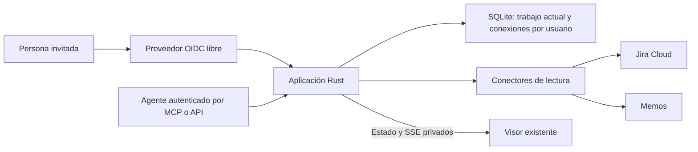

# Beta alojada: cuentas y orígenes

Fecha: 2026-10-27. Rama: `feature/multiuser-sources`.

Estado: plan de producto y backlog; la aplicación publicada todavía funciona como lector local. Las decisiones de arquitectura siguientes son recomendaciones del comité. No constituyen una verificación de despliegue o de interoperabilidad.

## Resultado esperado

Una persona invitada inicia sesión con Google o GitHub, abre un original desde Jira Cloud, Memos, texto o un archivo y recibe una propuesta por MCP/API, texto o archivo. Revisa el diff en el visor existente. Su último original y propuesta permanecen disponibles al volver a entrar o reiniciar el servicio. Cada persona ve únicamente su trabajo y conexiones.

La aplicación usa Jira y Memos como orígenes. No publica ni actualiza documentos en esos servicios. Tampoco genera propuestas con un modelo integrado: recibe el contenido que entrega la persona o su agente.

## Dirección confirmada

| Tema | Decisión del usuario |
| --- | --- |
| Cuentas | Varias personas, cada una con un espacio privado. |
| Admisión | Usuarios invitados, con acceso desde internet. |
| Login | Google o GitHub mediante un proveedor de identidad libre. |
| Capacidad inicial | Hasta diez personas simultáneas. |
| Retención funcional | Conservar solo el último original/propuesta por usuario hasta reemplazarlo o borrarlo, incluso tras cierres y reinicios. |
| Entrada de propuestas | MCP/API desde una IA, texto pegado y carga de archivos `.md`. |
| Orígenes externos | Jira Cloud y Memos, con conexiones personales de cada usuario. |
| Escritura externa | Fuera del alcance; los conectores solo leen contenido. |
| Gestión del trabajo | Issues de GitHub con historias, tareas y criterios de aceptación. |

## Producto de la primera beta

1. Entrar y retomar el único trabajo actual de la cuenta.
2. Elegir un origen en las cabeceras del visor, conservando el diseño sin lateral.
3. Leer una descripción de Jira o el contenido de una nota de Memos mediante una clave, ID o URL conocida.
4. Recibir una propuesta y comparar automáticamente, con procedencia y momento de lectura visibles.
5. Sustituir o borrar el trabajo, y desconectar las cuentas externas de forma independiente.

Para la beta se propone Jira **descripción del issue**, con título y referencia como metadatos, y Memos **contenido de la nota**. No se incluyen comentarios, adjuntos, búsqueda avanzada ni exploradores completos. Este recorte es una propuesta de alcance del comité, no una capacidad ya implementada.

La base se captura cuando se lee el origen. No cambia silenciosamente durante la revisión. Actualizar el origen será una acción explícita, con protección contra resultados obsoletos. Un fallo de red, de permisos, de conversión o de análisis conserva el trabajo válido anterior.

## Comité: alternativas y dos rondas

Se consultaron tres perspectivas independientes: producto visionario, arquitectura realista e identidad. En la primera ronda cada una propuso alternativas y consecuencias. En la segunda se contrastó una propuesta consolidada contra los requisitos confirmados.

| Alternativa | Beneficio | Coste o incumplimiento | Resultado |
| --- | --- | --- | --- |
| A. Rust + proveedor OIDC libre + SQLite para mddiff + una instancia | Reutiliza el visor y el motor; admite continuidad y separación de usuarios. | Hay que operar el proveedor de identidad y su almacenamiento, además de la aplicación. | Recomendada. |
| B. Rust + Better Auth en un servicio TypeScript | Librería libre con login social y extensiones de cuentas/OAuth. | Añade un runtime y la integración de administración y pantallas. | Viable si se prioriza identidad embebida. |
| C. Estado solo en memoria o navegador, sin persistencia del trabajo | Menor almacenamiento de servidor. | No garantiza retomar el trabajo después de cierres/reinicios. | Descartada por incumplir la continuidad. |

| Integrante | Voto final | Condición |
| --- | --- | --- |
| Producto | A | Preservar el recorrido completo, las cabeceras y la fuente congelada; sin convertirlo en un gestor de documentos. |
| Arquitectura | A | Aislamiento comprobado, credenciales protegidas y modo alojado sin lectura de rutas del host. |
| Identidad | A | Elegir el IdP después de probar login, invitaciones y MCP con el cliente real. |

Resultado: **3 votos por A**. Es un juicio de diseño, no una prueba de rendimiento ni una validación de seguridad. No hubo una elección definitiva del proveedor de identidad.

La discusión corrigió cuatro puntos: autenticar no equivale a aislar datos; una ruta del ordenador del agente no existe en un servidor remoto; un login OIDC web no demuestra compatibilidad MCP; y ausencia de historial en la aplicación no equivale a eliminación inmediata de todos los backups.

## Alternativas libres para identidad

Adopción consultada en repositorios oficiales el 2026-10-27. Las estrellas son una señal aproximada de popularidad, no una evaluación de calidad o seguridad.

| Opción | Modelo y licencia | Adopción aproximada | Consecuencia |
| --- | --- | ---: | --- |
| [Keycloak](https://github.com/keycloak/keycloak) | Proveedor de identidad autoalojado, Apache-2.0. | 37,6 mil estrellas | Administración de cuentas, sesiones y federación. Rust actúa como cliente OIDC. Primer candidato para el spike. |
| [authentik](https://github.com/goauthentik/authentik) | Proveedor autoalojado; núcleo MIT, con componentes Enterprise excluidos de esa licencia. | 26,1 mil estrellas | Alternativa con consola, flujos e invitaciones. Puede resultar más conveniente si se adopta como SSO compartido. |
| [Better Auth](https://github.com/better-auth/better-auth) | Librería TypeScript, MIT. | 30,5 mil estrellas | Responde literalmente a la petición de una librería; exige un servicio TypeScript junto a Rust y trabajo de integración. |

Las tres permiten construir el acceso confirmado sin desarrollar un sistema propio de contraseñas. Keycloak y authentik son servicios; Better Auth es una librería. Una librería OIDC de Rust implementa el protocolo de integración, pero no reemplaza la administración de cuentas del proveedor.

La recomendación es cerrar **OIDC como límite de integración**, probar Keycloak primero y mantener authentik como alternativa. Si ya existe un IdP adecuado, se evaluará reutilizarlo. No se instalará uno adicional por defecto sin comprobarlo.

La gratuidad se refiere a las funciones abiertas necesarias. Infraestructura, base de datos del IdP, actualizaciones y operación tienen coste. La SQLite propuesta es la base de **mddiff**; no sustituye la base de datos que requiera el proveedor de identidad, como PostgreSQL.

### Salida obligatoria del spike de identidad

1. Un invitado entra con Google o GitHub y un no invitado queda rechazado; no se habilita acceso público por el simple hecho de autenticarse.
2. Login web y MCP resuelven al mismo propietario interno, vinculado por `issuer` + `subject`, sin fusionar cuentas únicamente por email.
3. El cliente MCP real completa autorización, descubre herramientas y actualiza su espacio. Se verifican descubrimiento, PKCE, audiencia y permisos.
4. Credenciales caducadas, emisor/audiencia incorrectos, permisos insuficientes y acceso revocado producen rechazo.
5. Se documentan recursos, configuración, admisión y recuperación operativa del candidato elegido. No se decide únicamente por número de estrellas.

## Arquitectura propuesta

### Estado e identidad

El código actual mantiene snapshot, mutex y canal SSE globales. Estos tres elementos deben separarse por propietario. La identidad se obtiene de la sesión o token verificado; el cliente no puede seleccionar otro propietario mediante campos, rutas o identificadores.

Se propone una sola instancia de aplicación y SQLite en almacenamiento local persistente. No se colocará el archivo SQLite en un volumen de red compartido entre réplicas. Si aparece la necesidad de varias instancias, habrá que revisar persistencia, sesiones y distribución de eventos; no bastará con aumentar contenedores.

Cada usuario tendrá como máximo un par vigente y sus metadatos. El HTML/diff se puede recalcular. Las conexiones y la admisión son datos separados del trabajo. Reemplazar o borrar el trabajo no revoca por sí solo sus conexiones; desconectar un proveedor no borra silenciosamente la comparación ya capturada.

Las escrituras del trabajo serán atómicas y usarán una revisión esperada. Una propuesta que llega tarde no puede sobrescribir un trabajo más reciente: devuelve un conflicto comprensible. El borrado, refresco del origen, importación y actualización por agente siguen la misma regla.

### Modos local y alojado

El modo local conserva el uso actual de archivos dentro de `--root`, CLI y loopback. El modo alojado acepta contenido o referencias estructuradas de proveedor. No acepta rutas del sistema de archivos del servidor ni permite activar la lectura local desde una solicitud.

El límite actual de 16 KiB sirve para JSON con rutas; debe revisarse para transportar contenido. La propuesta inicial mantiene 2 MiB por documento y establece un límite HTTP que contemple ambos documentos y el overhead real de JSON o multipart. Habrá límites por usuario y de procesamiento para evitar que una persona agote el servicio.

### Conexiones personales y lectura

Las credenciales de Jira/Memos pertenecen a cada usuario, se guardan cifradas en el backend y no regresan al navegador, a las respuestas MCP, a logs ni al repositorio. La clave de cifrado se configura fuera de la base y se incluye en el procedimiento privado de recuperación.

Jira Cloud debe autorizar al usuario con los permisos de lectura necesarios, preferentemente mediante OAuth con consentimiento personal. La descripción usa ADF: se necesita una conversión determinista con pruebas y avisos visibles para contenido no representable. No se considerará exitosa una conversión que omita silenciosamente información.

Memos proporciona Markdown. El contrato debe comprobarse contra la versión soportada del servicio, porque los endpoints cambian entre versiones. Los PAT documentados heredan permisos del usuario: el plan no promete un token de solo lectura si el proveedor no lo ofrece. La aplicación sí tendrá un conector sin operaciones de escritura de negocio. El poder real de la credencial seguirá siendo un riesgo que debe comunicarse al conectar.

Los destinos de proveedores los configura la administración. No se añadirá una descarga de URL arbitraria con credenciales. El acceso a una instancia interna autorizada de Memos será una excepción concreta, sin abrir la red privada completa. Se limitan destinos, redirecciones, tiempo, tamaño y frecuencia.

### Borrado y respaldo

El producto no tendrá tabla de versiones, biblioteca ni historial recuperable. Sustituir un par elimina la versión anterior del estado activo; borrar vacía ese espacio y lo comunica a sus pestañas.

La retención de backups, registros transitorios y SQLite/WAL debe acordarse antes de prometer eliminación definitiva. Se decidirá si el trabajo actual entra en backups y por cuánto tiempo, o si se acepta perderlo ante pérdida del volumen manteniendo recuperación ante reinicios. Las cuentas, conexiones, claves y el IdP tienen su propia política de respaldo. Estas decisiones no están confirmadas todavía.

## Antes de exponerlo en internet

| Puerta | Evidencia necesaria |
| --- | --- |
| Identidad y aislamiento | Dos personas y dos agentes no pueden leer, reemplazar o recibir eventos del otro. Invitación y revocación son efectivas. |
| Entradas y conectores | El modo alojado no lee rutas locales; los conectores no escriben en proveedores; permisos, conversión, destinos y límites están probados. |
| Continuidad | Último par recuperable tras reinicio, conflictos sin sobrescritura y procedimiento de borrado/respaldo documentado y probado. |
| Operación | Contenedor sin privilegios, volumen persistente, secretos externos, origen HTTPS canónico y reglas explícitas de proxy. |
| Capacidad y recuperación | Carga de diez usuarios, memoria/latencia medidas, observabilidad sin contenido y restauración/rollback verificados. |

El despliegue inicial se planifica sobre un contenedor de aplicación dentro del entorno Docker/LXC disponible. Se verificarán capacidad, ubicación, red, certificados y publicación antes del despliegue. Direcciones, hostnames, rutas privadas y credenciales de operación no forman parte de este documento público.

No se introduce Kubernetes, Redis o replicación para esta beta. El hecho de usar un túnel HTTPS no reemplaza la autorización de la aplicación ni la protección del endpoint MCP.

## Backlog y orden de entrega

La épica y sus historias se publican en GitHub. Cada historia contiene tareas, dependencias y criterios observables; ninguna se marca como implementada por existir este plan.

| Fase | Resultado |
| --- | --- |
| 0. Reducir incertidumbre | Elegir IdP y validar MCP; resolver políticas de admisión, datos y backups. |
| 1. Servicio privado | Separar modo/propietario, autenticar, conservar el único trabajo e importar texto/archivo. |
| 2. Agentes y orígenes | API/MCP por usuario, conexiones personales, Memos y Jira con procedencia. |
| 3. Preparar operación | Concurrencia/eventos privados, contenedor reproducible y pruebas entre usuarios. |
| 4. Beta pública por invitación | Despliegue después de superar las puertas anteriores. |

Épica: [#1](https://github.com/joalceco/mddiff/issues/1). Milestone: [Beta alojada: cuentas y orígenes](https://github.com/joalceco/mddiff/milestone/1).

| Fase | Historia | Issue |
| --- | --- | --- |
| 0 | S01. Validar identidad libre, invitaciones y autorización MCP | [#2](https://github.com/joalceco/mddiff/issues/2) |
| 1 | S02. Separar el modo local del servicio alojado y su estado por propietario | [#3](https://github.com/joalceco/mddiff/issues/3) |
| 1 | S03. Permitir acceso privado por invitación con Google o GitHub | [#4](https://github.com/joalceco/mddiff/issues/4) |
| 1 | S04. Conservar y borrar el único trabajo actual de cada usuario | [#5](https://github.com/joalceco/mddiff/issues/5) |
| 1 | S05. Abrir originales y propuestas mediante texto o archivos Markdown | [#6](https://github.com/joalceco/mddiff/issues/6) |
| 2 | S06. Recibir propuestas por API y MCP remoto con identidad de usuario | [#7](https://github.com/joalceco/mddiff/issues/7) |
| 2 | S07. Gestionar conexiones personales protegidas y limitadas a lectura | [#8](https://github.com/joalceco/mddiff/issues/8) |
| 2 | S08. Leer una nota de Memos como original de una comparación | [#9](https://github.com/joalceco/mddiff/issues/9) |
| 2 | S09. Leer una descripción de Jira Cloud sin perder contenido en la conversión ADF | [#10](https://github.com/joalceco/mddiff/issues/10) |
| 2 | S10. Seleccionar orígenes y mostrar procedencia sin cambiar silenciosamente la base | [#11](https://github.com/joalceco/mddiff/issues/11) |
| 3 | S11. Sincronizar pestañas y agentes sin eventos cruzados ni sobrescrituras tardías | [#12](https://github.com/joalceco/mddiff/issues/12) |
| 3 | S12. Empaquetar una instancia alojada reproducible con datos y secretos separados | [#13](https://github.com/joalceco/mddiff/issues/13) |
| 3 | S13. Demostrar aislamiento, límites y capacidad de diez usuarios antes de publicar | [#14](https://github.com/joalceco/mddiff/issues/14) |
| 4 | S14. Desplegar la beta por invitación con respaldo, observabilidad y rollback | [#15](https://github.com/joalceco/mddiff/issues/15) |

Avance al 2026-10-27: S02, S04, S05, [S06: agentes remotos](remote-agents.md) y [S07: conexiones personales](personal-connections.md) están implementados. Jira Cloud y Memos tienen configuración personal protegida y comprobaciones de lectura; abrir su contenido como original sigue en S08/S09. S01 y S03 mantienen pendiente Google/GitHub; Keycloak y Codex se verificaron con usuarios sintéticos. El acceso público depende de cerrar las verificaciones y tareas operativas restantes.

## Fuera de esta beta

- Registro abierto, organizaciones, equipos o colaboración en tiempo real.
- Biblioteca, historial de Markdown, sincronización automática o versiones recuperables.
- Escritura en Jira/Memos, publicación de propuestas o generación de IA incorporada.
- Comentarios, adjuntos, exploradores completos o conectores adicionales.
- Reescritura del motor de diff, reconocimiento de movimientos o empaquetado nativo nuevo.

Como dirección futura se conservan la comparación entre dos orígenes diferentes y el reconocimiento de párrafos movidos, divididos o fusionados. No son requisitos de esta entrega.

## Fuentes primarias

Identidad: [administración de Keycloak](https://www.keycloak.org/docs/latest/server_admin/index.html), [contenedores Keycloak](https://www.keycloak.org/server/containers), [licencia de authentik](https://github.com/goauthentik/authentik/blob/main/LICENSE), [ediciones authentik](https://goauthentik.io/pricing/), [invitaciones authentik](https://docs.goauthentik.io/add-secure-apps/flows-stages/stages/invitation/), [instalación authentik](https://docs.goauthentik.io/install-config/install/docker-compose/), [Better Auth](https://better-auth.com/docs/introduction) y [su proveedor OAuth](https://better-auth.com/docs/plugins/oauth-provider).

Integración: [autorización MCP](https://modelcontextprotocol.io/specification/2025-11-25/basic/authorization), [API Jira Cloud v3](https://developer.atlassian.com/cloud/jira/platform/rest/v3/), [estructura ADF](https://developer.atlassian.com/cloud/jira/platform/apis/document/structure/), [API y tokens Memos](https://usememos.com/docs/integrations/api-access) y [lectura de Memos](https://usememos.com/docs/api/latest/memoservice/GetMemo).

## Verificación de este plan

Se revisaron los límites y puntos de entrada del código actual y se realizaron dos rondas de contraste entre tres agentes. No se desarrolló autenticación, persistencia, conectores ni despliegue. Las características de proveedores citadas deben verificarse de nuevo al fijar versiones y probar la integración real.
